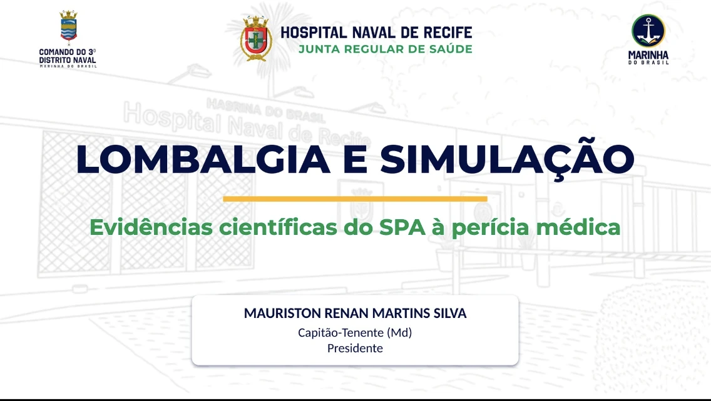
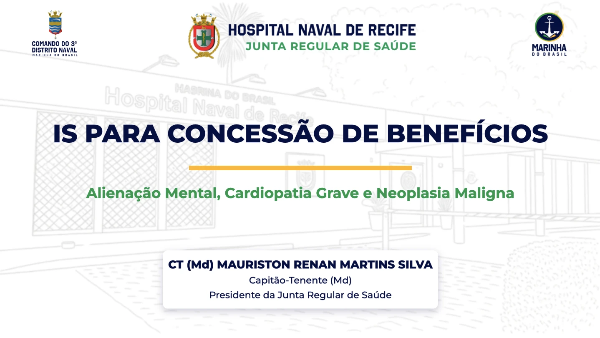

# JRS/HNRe — Apresentações

Junta Regular de Saúde · Hospital Naval de Recife

<table>
  <tr>
    <td align="center" width="50%">
      
    </td>
    <td align="center" width="50%">
      
    </td>
  </tr>
</table>
